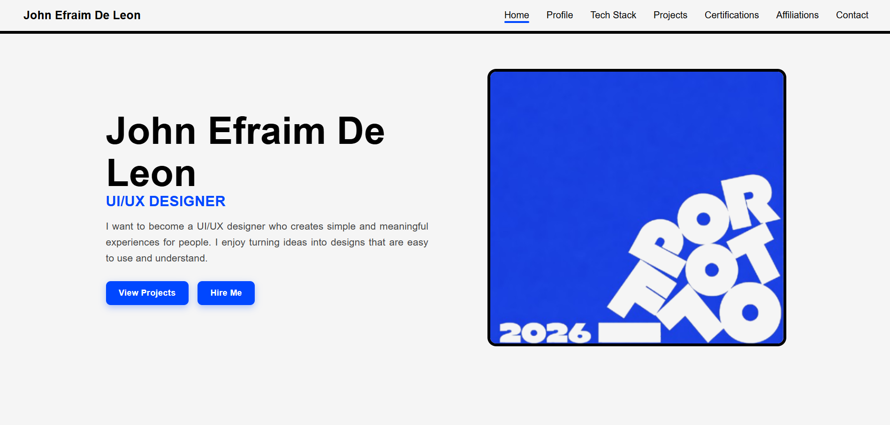

  

  

  
  
  
  
  

## 💫 About Me
- 🎓 IT Student at **STI College Malolos**
- 🎨 Aspiring **UI/UX Designer** & **Frontend Developer**
- 💼 **Open for internship** opportunities

## 🎨 Featured Work

<table>
  <tr>
    <td width="50%" valign="top">
      
      <h3 align="center">🌐 Personal Portfolio</h3>
      
My personal website showcasing who I am, my skills, and my work as an aspiring UI/UX designer.

      

        
      

      
<a href="https://epdcdln.github.io/JohnEp-Portfolio/"><b>🔗 Visit Site</b></a>

    </td>
    <td width="50%" valign="top">
      
      <h3 align="center">📦 Inventory Management System</h3>
      
A web-based system for managing products, stock, suppliers, and users in one dashboard.

      

        
      

      
<a href="https://inventorymanagement-theta-bice.vercel.app/"><b>🔗 Live Demo</b></a>

    </td>
  </tr>
</table>

## 🛠️ Tech Stack

### 🎨 Design

  
  

### 💻 Frontend

  

### ⚙️ Backend & Languages

  

### 🗄️ Databases & Cloud

  
  

### 🧰 Tools

  

---
